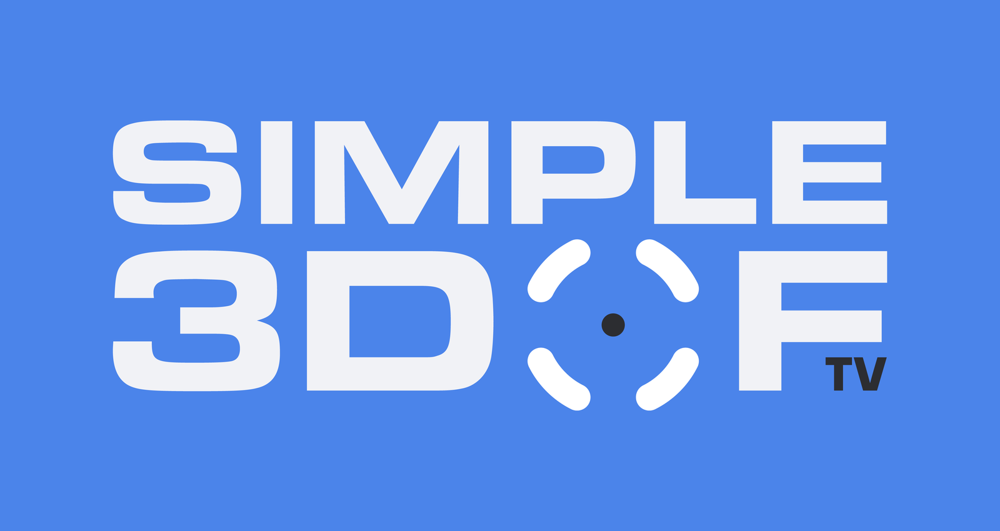
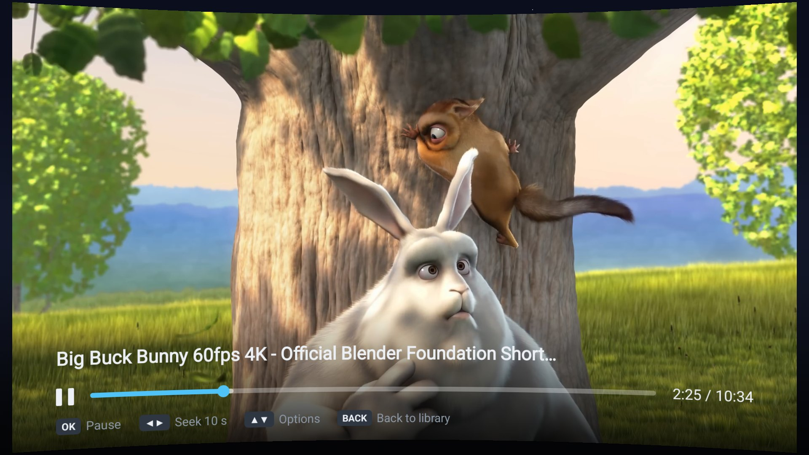
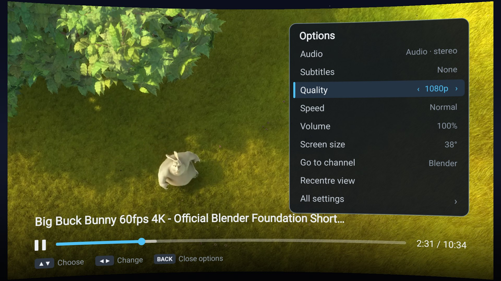
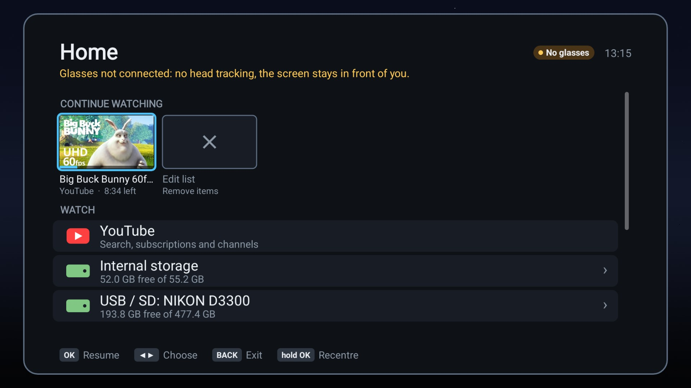
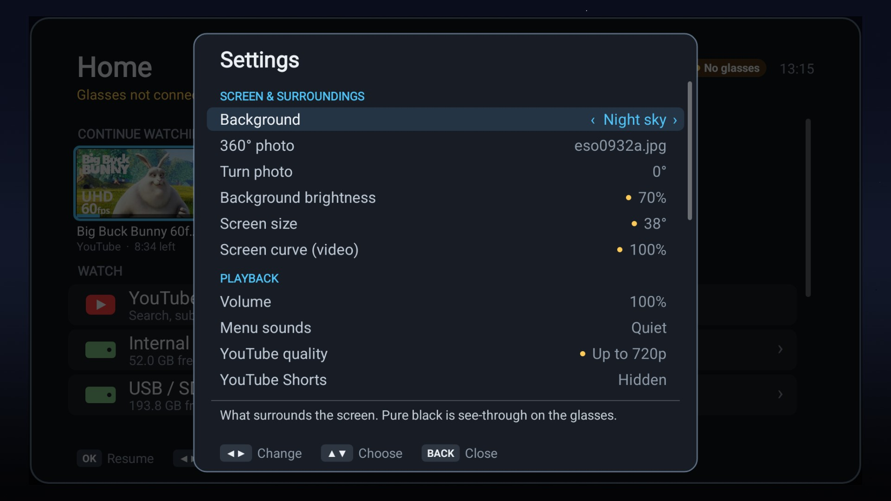

<p align="center"></p>

# Simple 3DOF TV

A head-tracked cinema for **VITURE** display glasses, running on the **Pocket TV Pro** (Android 14, 32-bit ARM only).
A floating 16:9 screen stays fixed in space as you look around. It plays your local and USB videos, has a web browser
(Stremio web, anything) driven by a D-pad or by the Pocket TV's own gyro as an air-mouse, and, if you build the YouTube
version, streams **YouTube natively** (search, your subscriptions, channels, up to 4K).

Everything is controlled with **D-pad, OK and BACK**; no menu button is needed.

<table>
  <tr>
    <td width="50%"><br><sub>Playing on the virtual screen (curve and size are adjustable).</sub></td>
    <td width="50%"><br><sub>The Options panel: audio, subtitles, <b>quality</b> (YouTube), speed, volume, size.</sub></td>
  </tr>
  <tr>
    <td width="50%"><br><sub>Home: continue watching, YouTube, storage and USB.</sub></td>
    <td width="50%"><br><sub>Settings, with a plain-language explanation under each one.</sub></td>
  </tr>
</table>

<sub>Screenshots are the flat view the glasses show, taken from the YouTube version without glasses attached (so the
screen stays centred and the header says "No glasses"). Video: "Big Buck Bunny", &copy; Blender Foundation, CC BY 3.0.</sub>

> Simple 3DOF TV is an independent project. It is not made, endorsed or supported by VITURE, Google/YouTube, or the
> makers of the Pocket TV. VITURE is a trademark of VITURE Inc.; YouTube and Google are trademarks of Google LLC.
> The names are used only to say what the app works with.

Engineering notes (architecture, device quirks, test recipes, known gaps) are in [DEVELOPMENT.md](DEVELOPMENT.md).

## Which version do you want?

There are two versions of the same app. **The only difference is YouTube**, and the reason is licensing, not quality.

| | **Simple 3DOF TV** (core) | **Simple 3DOF TV + YouTube** |
|---|---|---|
| Local / USB video, browser, head tracking, all settings | yes | yes |
| Native YouTube (search, subscriptions, channels, 1080p to 4K, quality switching) | **no** | **yes** |
| How you get it | **Download the APK** from GitHub Releases | **Build it yourself** (about three steps, below) |
| Why | free to redistribute with VITURE's libraries | contains GPL-3.0 code (NewPipeExtractor) that cannot be redistributed together with VITURE's proprietary libraries |

You can tell which one you have: the core version shows a *"YouTube is not in this edition"* row on Home and says
"core edition" under *Settings, About and legal*; the YouTube version has a **YouTube** row on Home.

### Get the core version (no YouTube)

Download `simple-3dof-tv-core-release.apk` from the GitHub Releases page and install it on the Pocket TV:

```
adb connect <pocket-tv-address>:5555
adb install -r simple-3dof-tv-core-release.apk
```

### Build the YouTube version yourself

You will need Windows 10/11, [Git for Windows](https://git-scm.com/download/win), about 5 GB of free disk space, and the
Pocket TV on your network. Everything else is downloaded for you.

1. **Get the code**
   ```
   git clone https://github.com/blackalice/Simple-3DOF-TV.git
   cd Simple-3DOF-TV
   ```
2. **Add VITURE's SDK.** It is VITURE's proprietary software, so it is not in this repository: download the VITURE glasses SDK
   for Android from VITURE's developer site and extract it into the `SDK` folder, so that this file exists:
   `SDK\android\armeabi-v7a\libglasses.so`
3. **Build it and put it on the Pocket TV.** In PowerShell, in the repository folder:
   ```powershell
   .\build.ps1 -Install -Device <pocket-tv-address>
   ```
   (Or leave off `-Install -Device ...` and install the APK from `dist\` yourself.)

That one command does everything: it checks the SDK is in place, offers to download the Android build tools (about 1.5 GB,
into a `.toolchain` folder, nothing system-wide; it asks you to accept Google's SDK licence), builds the TrueHD / DTS audio
decoders, builds the app, and installs it. **The first run takes 15 to 30 minutes, mostly downloads; later builds take a
couple of minutes.** To update later: `git pull`, then run the same command.

On Linux or macOS use `./build.sh youtube --install` (you provide the JDK, Android SDK and NDK; see the comments in the script).
For the version without YouTube, run `.\build.ps1 -Edition core`.

> The YouTube version is for **your own use**. Please do not publish the APK it produces: it contains GPL-3.0 code combined
> with VITURE's proprietary libraries, and you would not be allowed to redistribute that.

<details>
<summary>If something goes wrong</summary>

- *"The VITURE glasses SDK is missing"*: step 2 above; the path must be exactly `SDK\android\armeabi-v7a\libglasses.so`.
- *adb cannot connect*: turn on network (wireless) debugging on the Pocket TV, note its address, and check it is on the same
  network as your PC. You can also install over USB with `adb install -r dist\simple-3dof-tv-youtube-debug.apk`.
- *Git Bash not found, FFmpeg build skipped*: install Git for Windows and run the command again. The app works without it, but
  TrueHD / DTS audio is then handed to the TV's own audio system, which can make head tracking stutter on 4K films.
- *Out of memory in Gradle*: lower `-Xmx` in `gradle.properties` on a PC with a small pagefile.
- Anything else: run `.\build.ps1` again and read the last red line it prints.
</details>

### Other build options

```powershell
.\build.ps1 -Edition core      # the version without YouTube (debug-signed, for your own use)
.\build.ps1 -Release -CreateKey # signed release build of the core version; makes a signing key the first time
```
Any platform can also use Gradle directly (`./gradlew assembleYoutubeDebug`, `assembleCoreRelease`, ...); create
`local.properties` with `sdk.dir=...` first. The build copies VITURE's licence and notice files from the SDK into the APK
(shown under *Settings, About and legal*); they are never committed to this repository.

## Releasing (for the maintainer)

1. Work through [RELEASE_CHECKLIST.md](RELEASE_CHECKLIST.md) (placeholders in `legal/`, VITURE confirmation, etc.).
2. `.\build.ps1 -Release -CreateKey` the first time (it creates `release.jks` and `keystore.properties`, both git-ignored;
   **back them up**: updates only install over earlier releases signed with the same key). After that, `.\build.ps1 -Release`.
3. Attach `dist\simple-3dof-tv-core-release.apk` to a GitHub release together with `LICENSE`, `legal/EULA.md`,
   `legal/PRIVACY.md` and `legal/THIRD_PARTY_NOTICES.md`.

Release builds ignore all developer launch options. Only the *core* version is ever published.

## Using it

**Home** has three sections: *Continue watching* (with time left), *Watch* (YouTube, internal storage, USB/SD,
the indexed video list, **Browser** and any streams) and *Setup* (**Settings**). **Browser** opens a short list of
sites: web search, Stremio and YouTube on the web. The header shows whether the glasses are connected and the time.

| Key | Home / lists | Playing | Options panel / Settings | Browser (cursor) |
|---|---|---|---|---|
| Up / Down | select | open the **Options** panel | select | move the cursor (hold to speed up) |
| Left / Right | up a folder / (YouTube) open the video's channel | seek 10 s (hold: 30 s) | change the value | move the cursor |
| OK | open / play | play / pause | toggle / run | click |
| hold OK | recentre view | recentre view | recentre view | recentre view |
| BACK | up a folder; at Home press twice to exit | back to where you came from | close | close keyboard / toolbar, page back, then Home |
| Page Up / Down | page | next / previous video | | scroll |
| Play/Pause key | | play / pause | play / pause | space |

The footer of every screen shows only the keys that do something on the focused item.

- **Options** (Up or Down while playing) sits on the right so the picture stays visible: Audio, Subtitles, **Quality**
  (YouTube: Left/Right picks the highest resolution, 360p to 4K, and the video switches after a moment, keeping your place),
  Speed, Volume, Screen size, **Go to channel** (YouTube), Recentre view and **All settings**.
- **Settings** is grouped into Screen, Playback, Head tracking, Air mouse and Advanced (calibration). The focused
  setting is explained underneath, and a small amber dot marks values changed from the default.
- Menus and lists are always drawn on a **flat** screen; *Screen curve* only applies while a video plays (and while
  you adjust it, so you can see it).
- **Lost the screen?** When it is out of view, an arrow at the edge of your view points to it, with
  "Hold OK to recentre". By default it only appears once *none* of the screen is in view; Settings -> Head tracking
  has **Off-screen arrow** (on/off) and **Arrow appears when** (fully / mostly / half out of view).
- **Continue watching** on Home is a row of cards (YouTube thumbnails, progress along the bottom): Left/Right to
  choose, OK to resume. The last card, **Edit list**, opens a list where OK removes an item (press OK twice to
  confirm; *Clear all* at the top). YouTube's *Recently watched* row ends with the same card.
- **Menu sounds**: a soft tick when the selection moves and a blip when OK does something; silent at the ends of
  lists and during playback. Settings -> Playback -> **Menu sounds**: Off / Quiet / Normal.
- **Background** (Settings -> Screen & surroundings): *Night sky* (default: deep blue gradient and still stars),
  *Pure black* (nothing drawn; on the glasses black is see-through), *Dusk* (warm gradient, glow off to the left),
  *Grid room* (the original) and **360° photo**: any 2:1 equirectangular image in `Pictures/Panoramas` (or
  `Download`) on the device; Settings -> *360° photo* picks one (Left/Right), *Turn photo* rotates it in 15° steps.
  Photos are loaded at up to 4096x2048 and dimmed a little (Background brightness scales them).
  *Background brightness* scales it (default 35%). Every page and panel has a light outline so it stands out from the background.
- Starting a YouTube video shows what is loading; BACK cancels it.

Playing a video from YouTube and pressing BACK returns you to the YouTube list you started from.

## YouTube (native, YouTube edition only)

Library -> **YouTube** is a lightweight native client, with no WebView. Playback is ExoPlayer with hardware decoding
(up to the quality set in Settings -> *YouTube quality*, 360p to 2160p; live streams use HLS).

- **Home**: three tiles (Search, Subscriptions, Channels; Left/Right to choose), then *Recently watched* and
  *Trending* (if available in your region) as rows of cards, Left/Right to browse.
- **Search**: OK on the Search tile opens an alphabetical keyboard (rows wrap left/right; Space, Delete, Clear,
  Search on the bottom row). Up from the top row of keys moves to **recent searches** (empty box) or YouTube's
  **suggestions** (as you type); Left/Right to choose, OK to search, Down back to the keys. Results include videos and channels, with thumbnails,
  durations, view counts and upload age. Scrolling near the end loads more.
- **Shorts** are hidden by default (Settings -> Playback -> *YouTube Shorts*). Search, trending and channel pages
  say which videos are Shorts; the subscriptions feed (RSS) does not, so each new feed video is checked once against
  `youtube.com/shorts/<id>` (a Short answers 200, other videos redirect) and the answer is cached.
- **Channels** list: **Left/Right jump a letter** (the current letter shows top right). Avatars of imported
  channels are fetched in the background for the rows you look at, and saved.
- **Channel pages**: **Right** on any video or channel row opens that channel's page: its videos, and a
  **Subscribe / Unsubscribe** row. BACK walks back through the screens you came from.
- **Audio language**: when a video has several audio tracks, English is preferred, then the original track;
  audio-description tracks are never chosen.
- **Continue watching** includes YouTube videos (resume position is remembered).

### Subscriptions

There is no Google login. Subscriptions are stored on the device.

- **Subscriptions** (YouTube home) is a feed of the newest uploads from your channels, fetched from each channel's RSS
  feed (up to 6 per channel, newest 100 shown), cached, and refreshed when it is older than 20 minutes or via
  **Refresh feed**. The first refresh of several hundred channels takes a minute or two.
- **Channels** lists your subscriptions alphabetically.
- **Import**: Channels -> *Import subscriptions from a file* opens a picker listing the Google Takeout
  `subscriptions.csv` / NewPipe export (`.json`) files it finds in Downloads, Documents and the roots of USB/SD
  volumes, newest first. OK on the **Mode** row switches between:
  - *replace all channels* (default): the list matches the file exactly;
  - *merge into existing*: adds new channels and refreshes names, removes nothing.

  The result is shown on the import row (for example "Replaced with 384 channels (0 added, 0 removed, 0 renamed)").
- Getting your list: Google Takeout -> YouTube -> *subscriptions* gives `subscriptions.csv`; NewPipe's
  *Export subscriptions* gives a `.json`. Copy it to the device's Downloads (e.g. `adb push subscriptions.csv /sdcard/Download/`).

## Browser

- **Cursor**: D-pad, or the **gyro pointer** (Settings -> Gyro pointer: the Pocket TV in your hand is an air mouse).
  Pushing the cursor against the top / bottom edge scrolls the page.
- **Toolbar** (Back, Fwd, Reload, Library, URL, zoom, Desktop/Mobile, Keys): push **Up at the top of a page**, or
  dwell the pointer at the top edge. Left/Right to choose, OK to use, Down/BACK to close.
- **Keyboard**: opens by itself when you click a text field (the page shrinks above it so the field stays visible);
  or via the toolbar's URL / Keys. D-pad moves the highlight, OK types; a pointer hovering over a key selects it.
- Pages use a desktop user agent at 1280x720; zoom and desktop mode are remembered. Log-ins persist.
- **Stremio web** works for the UI and for plain HTTP streams; torrent streaming needs Stremio's local streaming
  server, which is not available on this device.

### Gyro pointer tuning

Settings -> **Gyro pointer** (on/off), **Pointer speed**, **Pointer axis** (which end of the Pocket TV points at the
screen: +X, -X, +Y, -Y, +Z, -Z). Yaw uses the world vertical so it works whatever way you grip it; pitch uses the
axis you pick. If the cursor moves the wrong way for up/down or left/right, try another axis.

## Local content

- **Storage**: browses *Internal storage* and every mounted *USB / SD* volume as plain folders. Needs "All files
  access": the first time there is a row that opens the TV's settings screen for it (or:
  `adb shell appops set com.portable3dof MANAGE_EXTERNAL_STORAGE allow`).
- **Subtitles**: embedded tracks, plus `.srt` / `.vtt` / `.ass` next to the video (`Movie.srt`, `Movie.en.srt`).
- Playback position is remembered per file. Progressive MP4/MKV, HLS and DASH are supported.
- **Audio**: TrueHD, MLP and DTS (including DTS-HD) are decoded inside the app with FFmpeg and played as PCM; everything
  else uses the Pocket TV's own decoders. (Handing TrueHD to the TV's audio system makes it burn a CPU core in a
  real-time thread, which made head movement stutter on 4K films.)

## Head tracking

- Source: **only** the glasses' IMU via the Viture SDK (120 Hz pose). Without glasses there is no head tracking:
  the screen stays straight in front of you (the Pocket TV's own sensors only drive the browser's air mouse). When
  the glasses connect the view is recentred; when they drop out it returns to straight ahead. Hold OK to recentre.
- Pose reads block in the SDK bridge (no polling). `PoseFilter` is an adaptive low-pass (smooth when still, nearly
  unfiltered when moving) plus a few ms of velocity prediction; tune both in Settings (smoothing *Off* +
  prediction 0 = raw tracking). The display is asked for its 120 Hz mode when the glasses offer it.

## Limitations

- **YouTube extraction can break** (YouTube edition). It uses [NewPipeExtractor](https://github.com/TeamNewPipe/NewPipeExtractor),
  which scrapes YouTube; when YouTube changes, bump the version in `app/build.gradle`. Not affiliated with YouTube; check
  their terms for your use.
- Imported channels show an initial instead of an avatar until their channel page has been opened.
- Large high-bitrate video from the Pocket TV's own SD slot is too slow (about 1 MB/s read); it is the card/slot,
  not the app.
- Chromium-based pages can be heavy on this hardware; prefer the native YouTube client.

## Source layout (`app/src/main/java/com/portable3dof/`; YouTube files are in `app/src/youtube/`, stand-ins in `app/src/core/`)

| File | Role |
|---|---|
| `MainActivity` | sensors, head-tracking source selection, recentre maths, gyro pointer, key routing |
| `GlassesProbe`, `GlassesBridge`, `cpp/p3dof_bridge.cpp` | USB permission, Viture SDK pose stream (JNI) |
| `PoseFilter`, `Settings` | smoothing/prediction; persisted tunables |
| `SceneRenderer`, `Overlay` | GL scene (room, curved/flat screen, video/browser/overlay layers, cursor, lost-screen arrow); Canvas-painted UI bitmap |
| `Ui` | shared palette, text helpers, key-hint chips, header status (glasses / clock / battery) |
| `PlayerUi` | home, HUD, subtitles, Options panel, settings, mode switching (library / player / settings / browser / YouTube) |
| `MediaEngine`, `ResumeStore`, `Library` | ExoPlayer wrapper, resume positions, storage browsing |
| `BrowserScreen`, `BrowserController`, `OnScreenKeyboard` | WebView on a virtual display, cursor/toolbar/keyboard |
| `LegalUi` | first-launch licence agreement and the About and legal pages |
| `YouTubeUi` | native YouTube screens (home, results, feed, channels, channel, import picker) |
| `YouTubeClient`, `YtDownloader`, `YtChunkedDataSource`, `YtMediaSource` | NewPipeExtractor wrapper (search, channels, feeds, stream choice), its HTTP client, and the playback source |
| `Subscriptions` | local channel list; Takeout CSV / NewPipe JSON import |

## Legal

- **Your code**: the source in this repository is released under the [MIT Licence](LICENSE). It does not include the
  VITURE SDK, which is proprietary.
- **The app (binary)**: use is subject to the [End User Licence Agreement](legal/EULA.md), shown on first launch. It
  restricts reverse engineering of VITURE's libraries and includes the indemnity VITURE's developer terms require.
- **Privacy**: [legal/PRIVACY.md](legal/PRIVACY.md). Short version: no accounts, no analytics, nothing sent to the author.
- **Third-party software**: [legal/THIRD_PARTY_NOTICES.md](legal/THIRD_PARTY_NOTICES.md). VITURE's own licence and open-source
  notice are included in the APK.
- The VITURE libraries are included only as a component of this app, in object-code form. They are not licensed for
  separate use and must not be added to a copy of this repository.
